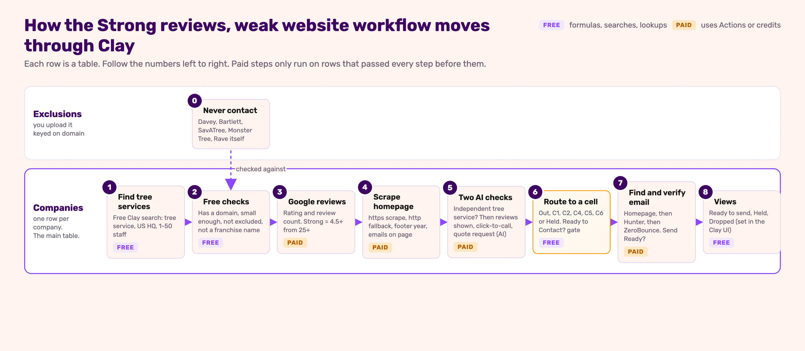

# Clay Build Guide: Strong Reviews, Weak Website (Rave, Week 2)

A step-by-step guide to the Clay table that implements `../workflow-spec.md`. Written for someone who has never built anything in Clay. **Unlike a normal build plan, this guide documents a table that has already been built and run** (100 rows, two batches of 50). Every column, formula, prompt, result and cost below is the real one. Where the build changed from the spec, or from its own first attempt, the guide says so.

Follow the parts in order to rebuild it. Each step tells you **why** it exists, **what to click**, **what to type**, **how to check it worked** and **what it costs**.

> **Don't skip the checks.** The most common Clay mistake is running a column on 100 rows before checking it on 1. Every paid step below ends with a 1-row proof (AI columns: 2 or 3 rows you can judge). The two failures in "When something goes wrong" (the HTTPS Check column and the first Find Emails and Verify columns) both came from skipping or misjudging a proof.

---

## Contents

- [What you are building](#what-you-are-building)
- [The real funnel](#the-real-funnel)
- [Clay words you need](#clay-words-you-need)
- [Before you start](#before-you-start)
- [Part 0. Set up the workbook](#part-0-set-up-the-workbook)
- [Part 1. Exclusions table](#part-1-exclusions-table)
- [Part 2. Find the tree services (free search)](#part-2-find-the-tree-services-free-search)
- [Part 3. Free checks](#part-3-free-checks)
- [Part 4. Google reviews (strong reviews signal)](#part-4-google-reviews-strong-reviews-signal)
- [Part 5. Scrape the homepage (website signals)](#part-5-scrape-the-homepage-website-signals)
- [Part 6. AI Fit Check (is it an independent tree service?)](#part-6-ai-fit-check)
- [Part 7. AI Site Gaps (the weak-website read)](#part-7-ai-site-gaps)
- [Part 8. Route each company to a cell](#part-8-route-each-company-to-a-cell)
- [Part 9. Find and verify the email](#part-9-find-and-verify-the-email)
- [Part 10. Views for the operator](#part-10-views-for-the-operator)
- [Part 11. Sequencer (not built in Clay)](#part-11-sequencer-not-built-in-clay)
- [What it costs](#what-it-costs)
- [Final checklist](#final-checklist)
- [When something goes wrong](#when-something-goes-wrong)
- [Things the spec needs to fix](#things-the-spec-needs-to-fix)

---

## What you are building

The spec's trigger: a US owner-run tree service has **strong Google reviews** (rating 4.5 or more from 25 or more reviews) and a **website that fails at least one check**. Each company is sorted into a "cell" by the first check that fires, and only cells that are ready to send get an email lookup.

The spec's three free website checks (no HTTPS, footer year 2022 or older, poor PageSpeed mobile score) found almost no weak sites in the test, and the PageSpeed route could not run (no API key). **Decision by Neil, 2026-11-21:** add an AI site-gap column that reads the homepage for three things instead: are customer reviews shown, is there a click-to-call link, can a visitor ask for a quote. That gives three new cells, C4, C5 and C6. The spec's copy only covers C1 to C3, so C4 to C6 need copy (see "Things the spec needs to fix").

This is **account-first**: the ICP starts from companies (owner-run trades), not from a person-level event, so there is one row per company and no people table. You will build **2 tables** inside **1 workbook** called `Rave | Strong reviews, weak website | Tree service`:



Each row of the picture is a table. The numbers are the order you build in. Step 0 is the list you upload first. The diagram merges the two AI columns into step 5; in this guide they are Parts 6 and 7.

Why this shape:
- **One row per company**, because every check (reviews, website, fit) is about the business, and the spec sends to the owner, found at the end.
- **Free gates first, cheapest paid gate next.** Reviews (0.2 data credits) run before scraping (0.1) only on companies that passed the free checks. The AI columns run only on companies that have strong reviews and a working homepage. Email lookups run only on rows that are already `Ready to Contact?`.
- **Nothing is sent from Clay.** The spec routes by list split into PlusVibe campaigns; Clay's job ends at the `Ready to send` view.

What a finished row in **Companies** looks like, reading left to right (made-up values, no real business):

| Company | Strong Reviews? | Business Type | Biggest Site Gap | Cell | Ready to Contact? | Best Email | Email Source | Email Status | Send Ready? |
|---|---|---|---|---|---|---|---|---|---|
| A tree service in the test list | true | independent_tree_service | reviews_not_shown | C4 Reviews not shown | true | (an address on its own domain) | Homepage | valid | true |

---

## The real funnel

100 rows from the free Clay search "tree service, US HQ, 1-50 staff" (886 results). Batch 1 took the first 50. Batch 2 took 50 more, using only names containing "tree" or "arbor".

| Stage | Result |
|---|---|
| Free checks (Part 3) | 100 of 100 pass |
| Google reviews found (Part 4) | 94 of 99 |
| Strong reviews (4.5+ from 25+) | 26 in batch 1, about 33 in batch 2 (about 59 in all) |
| AI Fit Check, batch 1 only | 10 independent tree services, 12 not tree service |
| Final cell, all 100 rows | Out: reviews not strong **40** · C4 Reviews not shown **25** · Out: not an independent tree service **17** · Held: no gap found **10** · Out: site down **5** · C2 Old footer **2** · C6 No quote request **1** |
| Ready to Contact? | **28** (C4 25 + C2 2 + C6 1) |
| C1 Not secure, C5 No click-to-call | 0 rows each |
| Emails for the 28 | 14 from their own homepage, 6 from Hunter, 8 not found |
| ZeroBounce on the 20 emails | 9 valid, 9 do_not_mail, 2 invalid |
| Email Matches Company? | 20 of 20 |
| **Send Ready?** | **9** |

The 7 final cells add to 100. The "about 59" strong-review count and the 60 rows that are not "Out: reviews not strong" differ by one, because batch 2's count was an approximation.

---

## Clay words you need

| Word | What it means |
|---|---|
| **Workbook** | A folder of tables for one campaign. |
| **Table** | A spreadsheet. Here, one row per company. |
| **Source** | Where a table's rows come from (a Clay search, a CSV, another table). |
| **Column** | One piece of information per row. Three kinds matter: **plain** (imported or typed), **formula** (Clay calculates it, free), **enrichment / action** (Clay calls a data provider, a scraper or AI, usually costs). |
| **Formula** | A small calculation, like a spreadsheet formula. Free. Clay has an AI helper: describe what you want in plain English and it writes the formula. |
| **Enrichment** | A column that looks something up (Google rating, an email). Costs **Actions** and often **Data Credits**. |
| **Lookup** | A column that reads a matching row from another table in your workbook. Free. |
| **Run condition** ("Only run if") | A rule on a paid column: it only runs on rows where the rule is true. This is how you avoid paying for rows you will throw away. |
| **Auto-run** | When on, new columns run on every row by themselves. **Keep it off** while building. |
| **Actions** | Clay's main usage meter. About 1 Action per enrichment per row. |
| **Data Credits** | A second meter, used when Clay pays a data provider (reviews, scrapes, AI, emails). This build's costs are quoted in data credits. |
| **Use AI** | A column that sends a prompt to an AI model and returns text or JSON. Here: Gemini 3 Flash. |
| **Cell** | Not a spreadsheet cell: the spec's word for a routing bucket (C1, C2, ...). The `Cell` column holds it. |
| **View** | A saved filter on a table, like "only rows ready to send". |

---

## Before you start

- [ ] **Clay account** with access to the workspace you build in. Note which plan it is on (Settings, Plans and billing) and the data credit balance before you start (you will want a before and after).
- [ ] **Connections** (Settings, Connections): a Gemini / Use AI connection, Hunter (own key) and the Clay-managed ZeroBounce. Without them the AI and email columns cannot run.
- [ ] `../workflow-spec.md` open next to this guide.
- [ ] **Exclusions list** ready (Part 1 gives the exact rows).
- [ ] **Test size:** 50 rows first, then a second 50 (this is what was run).
- [ ] Decide who watches the credit counter. Write the number down after every paid step.

---

## Part 0. Set up the workbook

**Why:** one workbook holds both tables; auto-run off prevents accidental spend.

1. Create a workbook named `Rave | Strong reviews, weak website | Tree service` with a blank table named `Companies`.
2. In the same workbook, add a second blank table named `Exclusions`.
3. On **both** tables, open the table settings (the gear or "..." menu at the top) and turn **Auto-run / Auto-update OFF**. Do this before adding any column.

**Check:** reopen the settings on each table and confirm auto-run reads off.
**Cost:** free.

---

## Part 1. Exclusions table

**Why:** spec section 2 excludes franchises and businesses already approached. Every lookup matches on **domain**, never on name.

1. In `Exclusions`, add three columns: `Company Name` (text), `Domain` (**URL** type), `Type` (text).
2. Add exactly these 5 rows. Domains are written plain: no `https://`, no `www.`, no trailing slash.

| Company Name | Domain | Type |
|---|---|---|
| Davey Tree Expert Company | davey.com | Franchise / national chain |
| Bartlett Tree Experts | bartlett.com | Franchise / national chain |
| SavATree | savatree.com | Franchise / national chain |
| Monster Tree Service | monstertreeservice.com | Franchise |
| Rave | ravegtm.com | Own company |

3. Clay may seed a few blank rows when it creates a table. Delete any row where every cell is empty.

**Check:** 5 rows, each with a domain. Leave a domain blank rather than guess one.
**Cost:** free.

> **Not covered yet:** the spec also excludes businesses already in a Rave campaign (Localpipe `exclude_existing_lists`). This table only holds the 5 rows above. Add loaded-campaign domains here before a real send (see "Things the spec needs to fix").

---

## Part 2. Find the tree services (free search)

**Why:** spec section 3 names Localpipe as the source, but this build used Clay's free company search (the decision for Week 2). Searches and importing their results cost nothing.

1. In `Companies`, add a source: **Find companies** (may be called **Add data**, then **Find companies**).
2. Set the filters:

| Filter | Set it to | Why |
|---|---|---|
| Keyword / industry | tree service | The trade |
| Company HQ country | United States | Spec ICP box |
| Company size | 1 to 50 staff (buckets 1, 2-10, 11-50) | Owner-run |

3. Read the **count** in the preview. It is free. The test showed **886 results**. Write it down.
4. Import **50** rows (batch 1). The second batch of 50 filtered the same search to names containing "tree" or "arbor", because the raw search returned many landscapers and lawn companies.
5. Make these columns (the search fills them): `Company Name`, `Domain` (URL), `Company Size`, `Location`, `Industry`, `Description`, `LinkedIn URL` (URL), `Clay Company ID`.
6. **Deduplicate on `Domain`.** Write domains plain, as in Part 1.

**Check:** 50 rows, each with a Domain. Open 3 and confirm they are tree-related businesses. Note the Industry column says "Landscaping Services" for these rows: that is Clay's label, not a bug.
**Cost:** free.

---

## Part 3. Free checks

**Why:** drop rows we know are wrong before spending anything (spec section 2). All five columns are free.

### 3.1 `Exclusions Match` (lookup)

1. **+ Add column**, then search for **Lookup single row in other table**.
2. Table: `Exclusions`. Match column in Exclusions: `Domain`. Operator: equals. Value from this table: `{{Domain}}`.
3. Run it on all rows (lookups are free).

**Check:** temporarily add a test domain from your table to `Exclusions`; the match should fill in. Delete the test row.

### 3.2 Four formulas

| Column | Plain English | Formula |
|---|---|---|
| `Is Excluded?` | True when Exclusions Match found a row with a Type | `!!({{Exclusions Match}}?.["Type"] \|\| {{Exclusions Match}}?.record?.["Type"])` |
| `Size OK?` | True when Company Size is 1, 2-10 or 11-50 | `["1","2-10","11-50"].includes({{Company Size}})` |
| `Franchise Name?` | True when the company name matches a national tree-care or lawn franchise | `/davey\|bartlett\|savatree\|monster tree\|arbor-?nomics\|trugreen\|weed man\|lawn doctor\|the grounds guys\|u\.?s\.? lawns/i.test({{Company Name}} \|\| "")` |
| `Pass Free?` | True when there is a Domain, Size OK is true, and it is not excluded and not a franchise name | `!!{{Domain}} && {{Size OK?}} && !{{Is Excluded?}} && !{{Franchise Name?}}` |

(In a Markdown table the `|` inside formulas is escaped as `\|`. Type a plain `|` in Clay.)

Set `Is Excluded?`, `Size OK?`, `Franchise Name?` and `Pass Free?` to data type **boolean**.

**Check:** sort by `Pass Free?`. Open every false row and confirm it deserves to be out. All 100 rows in the test passed, so there was nothing to open. `Pass Free?` is the run condition every paid column below depends on.
**Cost:** free.

---

## Part 4. Google reviews (strong reviews signal)

**Why:** signals S1 and S2 (rating 4.5 or more, 25 or more reviews). This is the cheapest paid gate and it knocks out the most rows, so it runs before the scrape.

1. **+ Add column**, then **Google reviews** (Clay's "Company to Google review score" enrichment; may be listed under Google Maps or Reviews).
2. Inputs: company name `{{Company Name}}`, company website `{{Domain}}`, keyword `tree service`.
3. **Run condition:** `{{Pass Free?}}`
4. Run on **1 row**. Open the cell: you should see a `rating` and a `reviews` count. Compare with Google Maps by hand.
5. Then run on the rest.

Three free formulas read the result:

| Column | Plain English | Formula |
|---|---|---|
| `Google Rating` | The star rating from Google Reviews, blank if none | `{{Google Reviews}}?.rating ?? ""` |
| `Google Review Count` | The number of reviews, blank if none | `{{Google Reviews}}?.reviews ?? ""` |
| `Strong Reviews?` | Rating 4.5 or more and 25 or more reviews | `Number({{Google Rating}}) >= 4.5 && Number({{Google Review Count}}) >= 25` |

Set `Google Rating` and `Google Review Count` to **number**, `Strong Reviews?` to **boolean**.

**Check:** the 1 proof row's rating and count match Google Maps. Rows with no Google result show blank and `Strong Reviews?` false, so they go to "Out: reviews not strong".
**Cost:** 0.2 data credits per row. Real: about **19.8** for the 100 rows. Result: about 59 strong.

> Thresholds (4.5, 25) are the spec's own and are not measured. The spec says to re-set them after the first pass.

---

## Part 5. Scrape the homepage (website signals)

**Why:** spec signals S3 (not secure) and S4 (old footer year), plus the text the two AI columns read. Scraping `https://domain` doubles as the HTTPS check: if the scrape succeeds, the site serves HTTPS.

### 5.1 `Scrape Homepage`

1. **+ Add column**, then **Scrape website** (Clay's `scrape-website` utility).
2. URL: `"https://" + {{Domain}}`
3. **Run condition:** `{{Strong Reviews?}}`
4. Run on **1 row**. Open the cell: you should see `title`, `bodyText`, `emails` and `links`.
5. Then run on the rest.

**Cost:** 0.1 data credits per row. Real: about **5.5** (so about 55 rows ran).

### 5.2 `Scrape HTTP Fallback`

**Why:** to tell "site is not secure" apart from "site is down". It scrapes `http://` only where the `https://` scrape failed.

1. Same **Scrape website** column. URL: `"http://" + {{Domain}}`
2. **Run condition:** it must run only where `Strong Reviews?` is true and `Scrape Homepage` came back empty (the https scrape failed). Write the condition with the formula editor's `/` column picker, using `{{Strong Reviews?}}` and `{{Scrape Homepage}}`.
3. Run on **1 row** whose https scrape failed, if you have one.

Meaning of the pair of columns: https works = secure. https fails but http works = **not secure**. Both fail = **site down**.

**Cost:** about 0 in the test.

### 5.3 Formulas on the scrape

| Column | Plain English | Formula |
|---|---|---|
| `Footer Year` | The highest year found within 80 characters after a copyright sign or the word "copyright" on the homepage; blank if none | see below |
| `Not Secure?` | Strong reviews, the https scrape failed, and the http scrape worked | `{{Strong Reviews?}} && !{{Scrape Homepage}} && !!{{Scrape HTTP Fallback}}` |
| `Page Emails On Domain` | Emails printed on their own homepage, kept only if they end in @ the company's domain | `(({{Scrape Homepage}}?.emails \|\| []).filter(e => String(e).toLowerCase().endsWith("@" + {{Domain}}))).join(", ")` |
| `Click-to-Call Links` | The number of tel: links on the homepage | `(({{Scrape Homepage}}?.links \|\| []).filter(l => /^tel:/i.test(String(l?.href \|\| ""))).length)` |
| `Mentions Quote?` | True when the homepage text mentions a quote or estimate | `/free (quote\|estimate)\|get a quote\|request a quote\|free estimate\|estimate/i.test(String({{Scrape Homepage}}?.bodyText \|\| ""))` |

`Footer Year` (final formula, after the fix described below):

```javascript
Math.max.apply(null, ((String({{Scrape Homepage}}?.bodyText || "").match(/(©|copyright).{0,80}/i) || [""])[0].match(/(?:19|20)[0-9]{2}/g) || ["0"]).map(Number)) || ""
```

Set `Footer Year` and `Click-to-Call Links` to **number**, `Not Secure?` and `Mentions Quote?` to **boolean**.

> **Why `Footer Year` changed.** The first version used an immediately-invoked function `(() => { ... })()` with `matchAll` and the spread operator. Clay rejects function expressions in formulas (see troubleshooting). The final version is one expression, using `Math.max.apply` instead of spread. It takes the highest year within 80 characters after the copyright sign.

> **Why `Not Secure?` changed.** The first version used a separate `HTTPS Check` HTTP API column. Its response could not be read from formulas, so it was deleted and replaced by the `Scrape HTTP Fallback` scrape above.

**Check:** open 3 rows. `Footer Year` should match the copyright line at the bottom of that homepage. A row whose https scrape worked must have `Not Secure?` false. Rows with no year show blank.
**Cost:** formulas are free.

> **Result:** only 2 rows ended in C2 Old footer and none in C1 Not secure. The spec's free website checks found almost no weak sites. That is the reason for Part 7.

---

## Part 6. AI Fit Check

**Why:** a formula cannot tell whether a business is an independent tree service. The Clay search returns landscapers and lawn companies under the same label (batch 1: 10 independent tree services, 12 not tree service). This is the "what the company actually does" judgement the spec's ICP needs (section 2).

1. **+ Add column**, then **Use AI**. Model: Gemini 3 Flash. Use your Gemini connection.
2. Prompt (the real prompt; each `{{column}}` is inserted with `/`):
   > *You check whether a company is an independent, owner-run tree service business in the United States. Use only the data below. Answer with JSON only, no code fences.*
   >
   > *Company name: {{Company Name}}*
   > *Website: {{Domain}}*
   > *LinkedIn description: (the first 800 characters of {{Description}})*
   > *Homepage title: {{Scrape Homepage}}'s title*
   > *Homepage text (start): (the first 2500 characters of {{Scrape Homepage}}'s bodyText)*
   >
   > *Return exactly: {"business_type": one of ["independent_tree_service", "franchise_or_chain", "not_tree_service", "unclear"], "offers_tree_work": one of ["yes", "no", "unclear"], "evidence": a short quote or fact from the data above that supports the answer}. independent_tree_service = a local company that does tree removal, trimming or arborist work itself and is not part of a national franchise. If tree work is only a minor add-on to landscaping or lawn care, use not_tree_service. If the data is too thin, use unclear.*
3. Output: JSON with `business_type`, `offers_tree_work`, `evidence`.
4. **Run condition:** `{{Strong Reviews?}} && !!{{Scrape Homepage}}`
5. Run on **3 rows you can judge yourself**: one obvious tree service, one obvious landscaper, one in between. Read each answer and its `evidence`. If one is wrong, fix the prompt and re-run the same 3. (The real column was proven on 3 rows before the rest.)
6. Then run on the rest.

Two formulas read the result. They must handle the AI sometimes wrapping JSON in code fences:

| Column | Plain English | Formula |
|---|---|---|
| `Business Type` | The business_type from the AI answer, blank if unreadable | `JSON.parse((String({{AI Fit Check}}?.response \|\| "{}").replace(/```json/g, "").replace(/```/g, "").trim()) \|\| "{}")?.business_type` |
| `AI Evidence` | The evidence from the AI answer, for checking | `JSON.parse((String({{AI Fit Check}}?.response \|\| "{}").replace(/```json/g, "").replace(/```/g, "").trim()) \|\| "{}")?.evidence` |

> **`unclear` counts as not ready.** Only `independent_tree_service` can be `Ready to Contact?`, and anything else becomes "Out: not an independent tree service" in Part 8.

**Check:** filter `Business Type` = `independent_tree_service` and read the `AI Evidence`. Would you agree with every one?
**Cost:** 0.5 data credits per row. Real: about **27** (about 54 rows ran). Result: 17 rows ended as "Out: not an independent tree service" over the 100.

---

## Part 7. AI Site Gaps

**Why:** **Neil's decision, 2026-11-21.** Part 5's free checks found almost no weak sites and the PageSpeed key was unavailable, so the weak-website signal is now read by AI from the homepage: are reviews shown, is there click-to-call, can a visitor ask for a quote. Each gap becomes its own routing cell (C4, C5, C6).

First add the two helper formulas from Part 5.3 (`Click-to-Call Links`, `Mentions Quote?`) if you have not yet; the prompt reads them.

1. **+ Add column**, then **Use AI**. Model: Gemini 3 Flash.
2. Prompt (the real prompt):
   > *You review the homepage of a local tree service for three things that turn a Google search into a phone call. Use only the data below. Answer with JSON only, no code fences.*
   >
   > *Company: {{Company Name}}*
   > *Google rating: {{Google Rating}} from {{Google Review Count}} reviews*
   > *Click-to-call (tel:) links on the page: {{Click-to-Call Links}}*
   > *Page mentions a quote or estimate: {{Mentions Quote?}}*
   > *Homepage text (start): (the first 3000 characters of {{Scrape Homepage}}'s bodyText)*
   >
   > *Return exactly: {"reviews_shown": one of ["yes", "no", "unclear"], "click_to_call": one of ["yes", "no", "unclear"], "quote_request": one of ["yes", "no", "unclear"], "biggest_gap": one of ["reviews_not_shown", "no_click_to_call", "no_quote_request", "none", "unclear"], "evidence": one short fact from the data above that shows the gap, or "none"}. reviews_shown = yes only if the page shows customer reviews, star ratings or testimonials. click_to_call = yes if there is at least one tel: link. quote_request = yes if visitors can ask for a quote or estimate. biggest_gap = reviews_not_shown when the Google rating is strong but the page shows no reviews; otherwise the first missing item in this order: click_to_call, quote_request; none if all three are present.*
3. Output: JSON with `reviews_shown`, `click_to_call`, `quote_request`, `biggest_gap`, `evidence`.
4. **Run condition:** `{{Business Type}} === "independent_tree_service" && !!{{Scrape Homepage}}`
5. Run on **3 rows you can judge**: open each homepage yourself and check the three answers.
6. Then run on the rest.

Two formulas read it:

| Column | Plain English | Formula |
|---|---|---|
| `Biggest Site Gap` | The biggest_gap from the AI answer, blank if unreadable | `JSON.parse((String({{AI Site Gaps}}?.response \|\| "{}").replace(/```json/g, "").replace(/```/g, "").trim()) \|\| "{}")?.biggest_gap \|\| ""` |
| `Site Gap Evidence` | The fact that shows the gap. Copy may only point to what is here | `JSON.parse((String({{AI Site Gaps}}?.response \|\| "{}").replace(/```json/g, "").replace(/```/g, "").trim()) \|\| "{}")?.evidence \|\| ""` |

> **`unclear` is not routed.** `unclear` and `none` both fall through to "Held: no gap found" in Part 8.

**Check:** filter by each `Biggest Site Gap` value and open one homepage of each. The `Site Gap Evidence` should be something you can see on the page.
**Cost:** 0.5 data credits per row. Real: about **19** (about 38 rows ran, the independent tree services). Result: 25 C4, 1 C6, 0 C5, 10 held.

---

## Part 8. Route each company to a cell

**Why:** spec section 5. One axis: the first check that fires, in priority order. This build adds the three AI cells after the spec's C1 and C2 and holds C3.

### 8.1 `Cell`

- **Plain English:** *"Out if reviews are not strong. Out if both the https and http scrapes failed (site down). Out if Business Type is not independent_tree_service. Otherwise the first that applies: C1 Not secure, C2 Old footer (footer year 2022 or older), C4 Reviews not shown, C5 No click-to-call, C6 No quote request. If none applies, Held."*
- **Formula** (the real routing, in spec order, first match wins):
```javascript
!{{Strong Reviews?}} ? "Out: reviews not strong" :
!{{Scrape Homepage}} && !{{Scrape HTTP Fallback}} ? "Out: site down" :
{{Business Type}} !== "independent_tree_service" ? "Out: not an independent tree service" :
{{Not Secure?}} ? "C1 Not secure" :
({{Footer Year}} && Number({{Footer Year}}) <= 2022) ? "C2 Old footer" :
{{Biggest Site Gap}} === "reviews_not_shown" ? "C4 Reviews not shown" :
{{Biggest Site Gap}} === "no_click_to_call" ? "C5 No click-to-call" :
{{Biggest Site Gap}} === "no_quote_request" ? "C6 No quote request" :
"Held: no gap found (C3 slow on phones needs a PageSpeed key)"
```

| Cell | Meaning | Real count (100 rows) |
|---|---|---|
| Out: reviews not strong | Rating or review count below the bar, or no Google result | 40 |
| Out: site down | Both scrapes failed | 5 |
| Out: not an independent tree service | AI says franchise, not tree service or unclear | 17 |
| C1 Not secure | https failed, http worked | 0 |
| C2 Old footer | Footer year 2022 or older | 2 |
| C3 Slow on phones | Held: needs a PageSpeed key | not routed |
| C4 Reviews not shown | Strong Google reviews, none on the site | 25 |
| C5 No click-to-call | No tel: link | 0 |
| C6 No quote request | No way to ask for a quote | 1 |
| Held: no gap found | Passed every check, nothing weak | 10 |

### 8.2 `Ready to Contact?`

- **Plain English:** *"True when Pass Free and Strong Reviews are true, Business Type is independent_tree_service, and Cell starts with C1, C2, C4, C5 or C6."*
- **Formula:**
```javascript
{{Pass Free?}} && {{Strong Reviews?}} && {{Business Type}} === "independent_tree_service" && /^C[12456] /.test({{Cell}} || "")
```
Set it to **boolean**.

> Held and Out rows stay in the table with `Ready to Contact?` false, which is the spec's "build, don't send" rule.

**Check:** filter `Ready to Contact?` = true (28 rows in the test). Open at least 5 across different cells and confirm each is a real independent tree service with a real gap. The AI columns are judgement, so spot-check, do not trust.
**Cost:** free.

---

## Part 9. Find and verify the email

**Why:** only look up emails for companies you will contact. The waterfall is: own homepage first (free), then Hunter (paid only when found), then ZeroBounce to verify.

> **What changed:** The first generic `Find Emails` and `Verify Email` columns failed because no provider account was attached: Clay rejected them with MISSING_AUTH ("Required auth account is missing"). Hunter needs the Clay-managed Hunter account and ZeroBounce the Clay-managed ZeroBounce account. The columns below are the ones that worked.

### 9.1 `Find Emails (Hunter)`

1. **+ Add column**, then **Find emails by company** (Hunter, `find-emails-for-company`). Use your own Hunter key.
2. Inputs: domain `{{Domain}}`, limit `5`.
3. **Run condition:** `{{Ready to Contact?}} && !{{Page Emails On Domain}}`. Companies with an email on their own homepage never pay for Hunter.
4. Run on **1 row**, read the result, then the rest.

**Cost:** 0.4 data credits **only when an email is found**. Real: about **5.2** in total. Hunter ran on 13 rows with no homepage email and found an email for 6 (13 x 0.4 = 5.2 was charged, so this run billed per lookup, not only per find; check the counter on yours).

### 9.2 Three formulas

| Column | Plain English | Formula |
|---|---|---|
| `Best Email` | The first homepage email, else the first Hunter email | `(String({{Page Emails On Domain}} \|\| "").split(",")[0] \|\| "").trim() \|\| (({{Find Emails (Hunter)}}?.emails \|\| [])[0]?.value \|\| "")` |
| `Email Source` | Homepage, Hunter or Not found | `{{Page Emails On Domain}} ? "Homepage" : ({{Best Email}} ? "Hunter" : "Not found")` |
| `Email Matches Company?` | The email ends in @ the company's domain | `String({{Best Email}} \|\| "").toLowerCase().endsWith("@" + String({{Domain}} \|\| "").toLowerCase())` |

Set `Best Email` to the **Email** type.

### 9.3 `Verify Email (ZeroBounce)`

1. **+ Add column**, then **Validate email** (`validate-email`), using the Clay-managed ZeroBounce. Turn **only safe** on.
2. Input: `{{Best Email}}`.
3. **Run condition:** `{{Ready to Contact?}} && !!{{Best Email}}`
4. Run on **1 row**, then the rest.

**Cost:** 0.1 data credits per email. Real: about **2.0** (20 emails).

### 9.4 `Email Status` and `Send Ready?`

| Column | Plain English | Formula |
|---|---|---|
| `Email Status` | The ZeroBounce result: valid, invalid, do_not_mail, catch-all or unknown | `String({{Verify Email (ZeroBounce)}}?.status \|\| {{Verify Email (ZeroBounce)}}?.result \|\| "")` |
| `Send Ready?` | Ready to Contact, the email matches the company, and the status is exactly valid | `{{Ready to Contact?}} && {{Email Matches Company?}} && /^valid$/i.test({{Email Status}} \|\| "")` |

**Check:** a `Send Ready?` row has an email on its own domain and status valid. Rows with `do_not_mail` or `invalid` stay false.
**Result:** 28 ready rows gave 20 emails (14 homepage, 6 Hunter, 8 not found). ZeroBounce: 9 valid, 9 do_not_mail, 2 invalid. All 20 matched the company domain. **9 Send Ready.**

> **Mismatch with the spec:** the spec says owner email (decision 38). Page emails and Hunter's first result are business addresses, not confirmed owner emails. See "Things the spec needs to fix".

---

## Part 10. Views for the operator

**Why:** someone opening the table later should see what matters. **These must be set in the Clay UI** (the build scripts did not create views).

In `Companies`, add these views (view dropdown at the top, then **+ New view**, then add a filter):

| View | Filter | Who uses it |
|---|---|---|
| `Ready to send` | `Send Ready?` = true | The person loading PlusVibe |
| `Held` | `Cell` starts with "Held" | Waiting on a PageSpeed key or on copy |
| `Dropped` | `Cell` starts with "Out" | Spot-checking the gates |

Also group the columns, in build order, so the table reads left to right: 1 Company (from search), 2 Free checks, 3 Google reviews, 4 Website signals, 5 AI columns, 6 Routing and gate, 7 Email waterfall. Give every column a plain-English description (the "Plain English" lines above) so anyone reading the table knows what it does.

**Check:** `Ready to send` shows 9 rows after the test. `Held` shows 10. `Dropped` shows 62 (40 + 17 + 5).
**Cost:** free.

---

## Part 11. Sequencer (not built in Clay)

No sequencer push column was built, and nothing in this table sends. The spec routes by **list split** (one PlusVibe campaign per cell, static copy in each), so the handover is: export the `Ready to send` view, split it by `Cell`, and load each cell into its own paused PlusVibe campaign. That is a human step after the spec's blockers are cleared (sample design exists at a live link, copy for C4 to C6 approved, `"not found"` blanked, S3 re-checked within 72 hours).

**Cost:** nothing in Clay.

---

## What it costs

Free: the search and its import, the Exclusions lookup, every formula, the views.

All real, for the 100 rows (data credits; the counter also showed a few hundred Actions in total):

| Step | Runs on | Real cost |
|---|---|---|
| Google Reviews (Part 4) | Rows that passed the free checks (100) | 0.2 per row, about **19.8** |
| Scrape Homepage (5.1) | Strong-review rows (about 55) | 0.1 per row, about **5.5** |
| Scrape HTTP Fallback (5.2) | Rows where the https scrape failed | about **0** |
| AI Fit Check (Part 6) | Strong rows with a homepage (about 54) | 0.5 per row, about **27** |
| AI Site Gaps (Part 7) | Independent tree services (about 38) | 0.5 per row, about **19** |
| Hunter, Find Emails (9.1) | Ready rows with no homepage email | 0.4 per email found, about **5.2** |
| ZeroBounce (9.3) | Ready rows with an email (20) | 0.1 per email, about **2.0** |
| **Total** | | **79.4 data credits**, plus a few hundred Actions |

The line items above add to about 78.5; the 79.4 is the total Clay's counter showed, so about 0.9 is unattributed. Treat the per-step numbers as approximate.

**Cost per result:** 79.4 credits for 100 companies is about 0.8 per company searched, and about 8.8 per Send Ready row (9 of them). Most of the spend is the two AI columns and the reviews lookup, all of which run before any email is found. Because the funnel is narrow (100 to about 59 to 28 to 9), volume is the main risk, as the spec says.

Watch the credit counter before and after each paid step and write the numbers down. That is your real cost per row.

---

## Final checklist

- [ ] Auto-run is **off** on both tables.
- [ ] Every paid column has a **run condition** (Parts 4 to 7 and 9).
- [ ] Every paid column was tested on 1 row (AI columns on 3 you can judge) and the cell was read before running more.
- [ ] `Companies` has no duplicate domains.
- [ ] No company from `Exclusions` appears in `Ready to send`.
- [ ] Held rows (`Cell` starting "Held") have `Ready to Contact?` false.
- [ ] No Out row has an email lookup run on it.
- [ ] Views `Ready to send`, `Held` and `Dropped` are set in the Clay UI.
- [ ] Every column has a plain-English description and the 7 groups are set.
- [ ] Nothing is loaded into PlusVibe and nothing is sent.
- [ ] Credits spent are written down per step.

---

## When something goes wrong

| What you see | Likely cause | Fix |
|---|---|---|
| A formula column shows an error or the formula is rejected | Clay rejects `try { }` blocks and `function(){}` expressions | Rewrite as a single expression: optional chaining (`?.`), `||`, `?:`, `.match()`, `Math.max.apply(null, ...)`. Avoid spread and `new Set` too |
| `Footer Year` blank on a page that has a year | The year is not within 80 characters of the copyright sign, or the page puts it in an image | Open the `bodyText` of the scrape and look; blank is the correct answer if it is not in the text |
| `Not Secure?` always false | `Scrape HTTP Fallback` never ran, or its run condition does not match "https scrape failed" | Check the fallback column's condition on a row where `Scrape Homepage` is empty |
| `Not Secure?` is true on a site that opens fine | The https scrape failed for another reason (timeout, blocked scraper) and the http one worked | Open the site in Chrome before trusting C1. Re-run the scrape on that row |
| An HTTP API column's response cannot be read in a formula (the deleted `HTTPS Check`) | The HTTP API column's response is not readable from formulas in this setup | Use a **Scrape website** column instead and test its output; do not build routing on an HTTP API result |
| PageSpeed Mobile returns a quota error | Google PageSpeed without an API key shares an exhausted quota | Create a free Google API key and re-add the column. Until then route C3 stays held |
| `Business Type` is blank | The AI answer was wrapped in code fences, or invalid JSON | The formula strips ` ```json ` fences; if still blank, open the `AI Fit Check` cell and read the raw text. Fix the prompt, re-run those rows |
| `Find Emails` and `Verify` columns fail or show empty results | The first versions had no provider account attached (MISSING_AUTH) | Use the `Find Emails (Hunter)` and `Verify Email (ZeroBounce)` columns of Part 9 and read the real cell once before writing formulas on it |
| ZeroBounce marks half the emails `do_not_mail` | 9 of 20 were do_not_mail. Likely cause, not verified per address: role inboxes such as info@ and office@, which ZeroBounce flags | Only `valid` is `Send Ready?`. Look at the addresses before blaming the column |
| Batch 2 returns landscapers and lawn companies | The raw search keyword is broad | Filter the search to names containing "tree" or "arbor" (this is what batch 2 did) |
| The credit counter jumps on a paid column | Its run condition is missing or wrong | Stop the run, fix the condition, run on 1 row |

---

## Things the spec needs to fix

The spec was not edited. Suggested changes, with the evidence from this build:

1. **Section 4 and 5 (signals, routing): add C4, C5, C6 and the AI Site Gaps read.** The spec's free checks (S3, S4) produced 0 C1 and 2 C2 rows in 100, and S5 PageSpeed cannot run without a key. Neil chose the AI site-gap column on 2026-11-21. The routing order is now Out checks, C1, C2, C4, C5, C6, Held.
2. **Section 5 and Copy: write copy for C4, C5 and C6.** The spec's copy only covers C1, C2 and C3. C4 (strong Google reviews, none on the site) is 25 of the 28 ready rows, so it matters most. Copy may only point to what `Site Gap Evidence` shows, and must not claim a number, per the spec's own variables rule.
3. **Section 3 (sources): Clay search, not Localpipe.** The test used Clay's free company search (886 results for "tree service, US HQ, 1-50 staff"), not Localpipe's 1,252 pool. Decide which is the source and keep the other for dedupe.
4. **Section 3 (owner email): the build finds business emails, not owner emails.** The spec follows decision 38 (owner email via Localpipe `/enrich`). This table uses emails printed on the homepage and Hunter's first result. Neither confirms an owner, and the spec's own open question (owner vs business email) is still open.
5. **Section 2 (exclusions): businesses already in a Rave campaign are not excluded here.** The Exclusions table has 5 rows. Add loaded-campaign domains, or a `place_id` check, before a send.
6. **Section 4 (S3 wording): "Not secure" is detected by scrape.** C1 means the https scrape failed and the http scrape worked. A scraper failure can look like that, so check C1 rows in Chrome before sending. The spec's 72-hour re-check applies here too.
7. **Section 3 (thresholds): re-set 4.5 and 25.** The spec says to re-set them after the first pass. The first pass gives about 59 strong rows of 100 (about 59 percent), so the review bar is not the tight gate; the independent-tree-service check (17 of the rest) is.
8. **Section 2 (exclude, franchises): franchise detection is a name list.** The `Franchise Name?` formula and the AI Fit Check catch national chains. Smaller regional chains need the Exclusions table.
9. **Section 7 (cadence): Clay does not hand off.** There is no sequencer column. Say in the spec that the handover is the `Ready to send` view split by `Cell` into PlusVibe campaigns.
